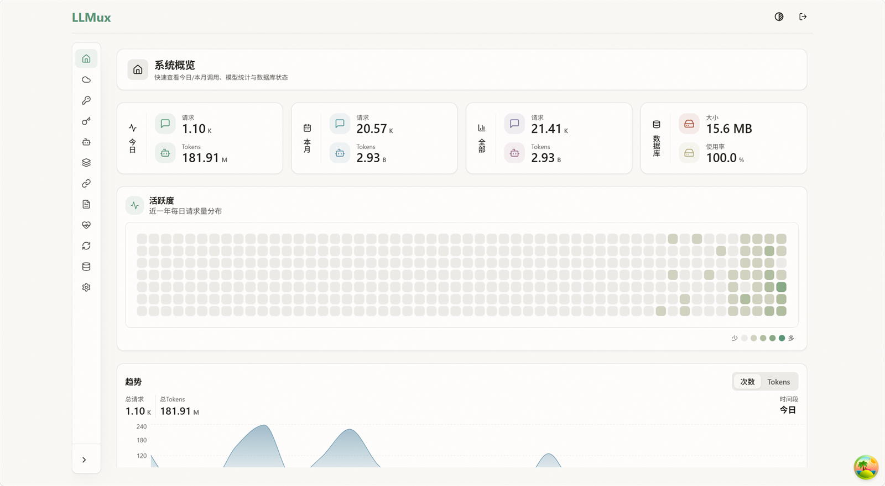
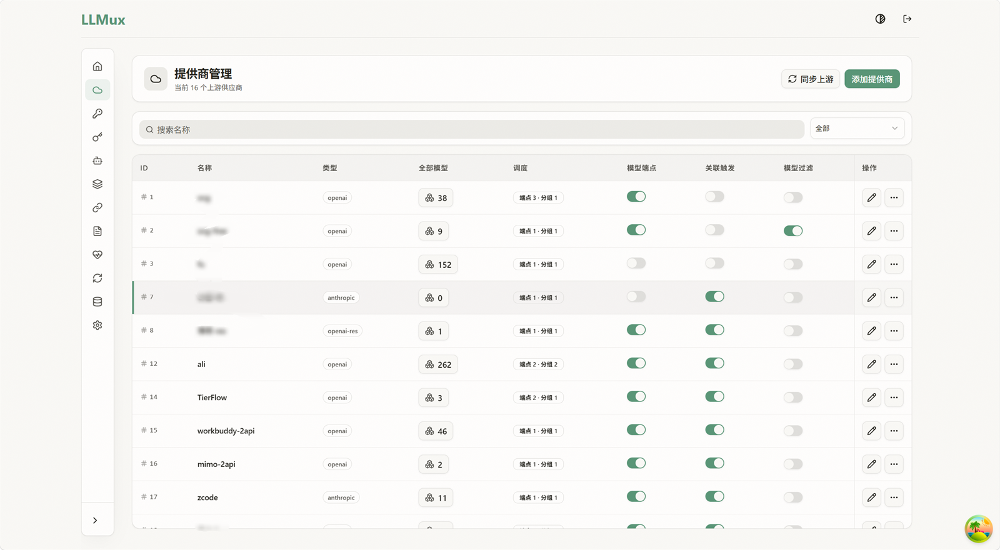
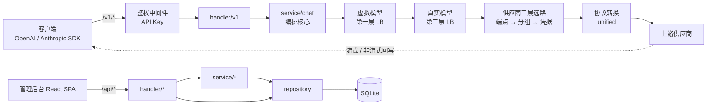

<div align="center">
  
  <h1>LLMux</h1>
  <p>多供应商 LLM API 网关 —— 统一出口、协议互转、两层负载均衡与自动故障转移。</p>
</div>

<p align="center">
  
  
  <a href="LICENSE"></a>
</p>

## 简介

LLMux 是一个自托管的 LLM API 网关与代理。对外，它提供与 OpenAI / Anthropic 兼容的 `/v1/*` 接口，让现有 SDK 与客户端工具直接接入；对内，它提供 Web 管理后台，用来管理供应商、号池与凭据、模型目录、模型关联、虚拟模型、健康检查与模型同步，并查看请求日志和用量指标。

一次请求依次经过：虚拟模型解析（第一层负载均衡）→ 真实模型 → 供应商内部三层选路（端点匹配 → 分组加权 → 凭据轮询）→ 协议转换 → 上游。任一环节失败都会在候选池内重试并自动切换到下一个候选。

## 界面预览

| 系统概览 | 提供商管理 |
|---|---|
|  |  |

更多截图见 `docs/screenshots/`。

## 功能特性

- **统一出口 + 协议互转**：入站支持 OpenAI Chat Completions、OpenAI Responses、Anthropic Messages；协议中枢走统一模型（`models/unified`），出站按端点协议适配。
- **协议与上游解耦**：新增一家 OpenAI 兼容上游只需在 `providers/` 注册元数据，转换层零改动。
- **两层负载均衡**：虚拟模型（真实模型级）→ 模型关联（供应商级，按优先级 + 权重）。
- **供应商内部三层选路**：端点匹配 → 分组加权 → 凭据轮询 + 冷却。
- **号池与凭据管理**：号池容器支持批量导入与按凭据测试；凭据加密存储，可启停恢复、备注与按归属过滤。
- **调用方 API Key**：多 key 管理，值以密文 + hash 两种形式存储，是 `/v1` 鉴权的数据源。
- **健康检查与自动调整**：失败触发权重 / 优先级衰减，连续失败自动停用关联。
- **模型同步与自动关联**：从上游拉取模型列表并自动建立模型-供应商关联。
- **可观测性**：请求日志、ChatIO 详情、仪表盘指标与数据保留策略。
- **可靠回写**：候选池重试、跨真实模型故障转移、全局总超时与首字节等待看门狗。

## 架构



依赖方向：`webui` / 外部客户端 → `middleware` + `handler` → `service` → `providers` + `repository` → `models` + SQLite。完整设计说明见 [docs/architecture/README.md](docs/architecture/README.md)。

## 快速开始

### 前置要求

- Go 1.25+
- Node.js 20+ 与 pnpm 10+（构建管理后台需要）
- 可选：Docker

> [!IMPORTANT]
> `main.go` 通过 `//go:embed webui/dist` 内嵌管理后台，而 `webui/dist` 不入库。首次运行前必须先构建前端，否则 Go 编译会报 `pattern webui/dist: no matching files found`。

### 从源码运行

```bash
git clone https://github.com/qkf688/llmux.git
cd llmux
cp .env.example .env    # 至少填入 JWT_SECRET
make webui              # 构建管理后台到 webui/dist（供 embed）
make run                # 启动服务，默认 http://localhost:7070
```

Windows 用户可直接用脚本，它会先构建前端并释放 7070 端口：

```bat
copy .env.example .env
run.bat                 :: 构建 webui 后启动
run.bat --no-build      :: 跳过前端构建，使用已有 webui/dist
```

启动后打开 http://localhost:7070 进入管理后台。首次启动若未设置 `ADMIN_PASSWORD`，密码会随机生成并打印到日志。

### Docker

```bash
docker compose up -d
```

或直接运行镜像：

```bash
docker run -d --name llmux -p 7070:7070 \
  -v $(pwd)/db:/app/db \
  -e JWT_SECRET=<你的密钥> \
  -e GIN_MODE=release \
  qkf688/llmux:latest
```

> [!WARNING]
> `CREDENTIAL_ENCRYPTION_KEY` 是部署级永久密钥。换掉它会让已存储的凭据密文全部不可读，必须重新录入全部凭据。未设置时首启会自动生成并落盘 `./db/credential.key`，请连同 `db/` 一起备份。

### 环境变量

| 变量 | 必填 | 说明 |
|---|---|---|
| `JWT_SECRET` | 是 | 管理后台 JWT 签名密钥。未设置时进程启动即退出。 |
| `CREDENTIAL_ENCRYPTION_KEY` | 否 | 凭据加密密钥，32 字节 hex。未设置时首启自动生成 `./db/credential.key`。 |
| `ADMIN_PASSWORD` | 否 | 首启动 admin 密码，留空则随机生成并打印到日志。 |
| `TRUSTED_PROXIES` | 否 | 可信代理网段（逗号分隔 IP/CIDR）。只有网段内代理的 `X-Forwarded-For` 会被采信为访问日志 ClientIP；留空 = 全关，直连部署默认安全。 |
| `GIN_MODE` | 否 | `debug` / `release` / `test`。 |
| `TZ` | 否 | 时区，如 `Asia/Shanghai`。 |

支持项目根目录 `.env` 文件（启动时自动加载，模板见 `.env.example`）。

## 客户端接入

`/v1` 接口使用管理后台创建的 API Key 鉴权（`Authorization: Bearer <key>`）。

| 方法 | 路径 | 说明 |
|---|---|---|
| `GET` | `/v1/models` | 模型列表 |
| `POST` | `/v1/chat/completions` | OpenAI Chat Completions |
| `POST` | `/v1/responses` | OpenAI Responses |
| `POST` | `/v1/messages` | Anthropic Messages |
| `POST` | `/v1/count_tokens` | Token 计数 |

```bash
curl http://localhost:7070/v1/chat/completions \
  -H "Content-Type: application/json" \
  -H "Authorization: Bearer <YOUR_API_KEY>" \
  -d '{
    "model": "gpt-4-balanced",
    "messages": [{"role": "user", "content": "Hello"}],
    "stream": true
  }'
```

`model` 可以是真实模型名，也可以是虚拟模型名 —— 虚拟模型会按配置的策略在第一层做负载均衡与故障转移。详见 [虚拟模型使用指南](docs/virtual-models-guide.md)。

## 开发

| 命令 | 作用 |
|---|---|
| `make run` | 格式化 + 整理依赖 + 建库目录 + 启动后端（:7070） |
| `make webui` | 构建管理后台到 `webui/dist`（供 Go embed） |
| `make test` | 全量 Go 测试 `go test ./... -count=1` |
| `make check` | 提交前一键自查：`fmt` + `vet` + `test` |
| `make fmt` / `make tidy` | `go fmt ./...` / `go mod tidy` |

前端（在 `webui/` 下）：

```bash
pnpm dev         # Vite HMR，:5173，/api 代理到 :7070
pnpm build       # tsc -b && vite build
pnpm typecheck   # 仅类型检查，比 build 快
pnpm lint        # eslint
pnpm test        # vitest
```

前后端分离调试：

```bat
dev.bat                  :: 或 .\dev.ps1
dev.ps1 -BackendOnly     :: 只起后端
dev.ps1 -FrontendOnly    :: 只起前端
```

> [!NOTE]
> 改完前端并希望体现在 Go 二进制里，必须重新执行 `pnpm run build`（或 `make webui`）—— 管理后台是构建产物内嵌进二进制的。

## 文档

| 文档 | 内容 |
|---|---|
| [docs/architecture/README.md](docs/architecture/README.md) | 架构总览：模块索引、依赖方向、请求主路径 |
| [docs/architecture/modules/](docs/architecture/modules/) | 各业务模块的职责、边界与接口契约 |
| [docs/architecture/interactions.md](docs/architecture/interactions.md) | 模块间调用、Hook 与注册表 |
| [docs/architecture/conventions.md](docs/architecture/conventions.md) | 命名规范 |
| [docs/guides/extension.md](docs/guides/extension.md) | 新增供应商 / 协议 style / 策略 / 设置项 / 页面 |
| [docs/guides/framework-conventions.md](docs/guides/framework-conventions.md) | Gin 关闭序、前端 dialog、协议代理约定 |
| [docs/virtual-models-guide.md](docs/virtual-models-guide.md) | 虚拟模型使用指南 |
| [AGENTS.md](AGENTS.md) | AI 与人类协作者的协作规范 |

本项目基于 [MIT 许可证](LICENSE) 开源。
